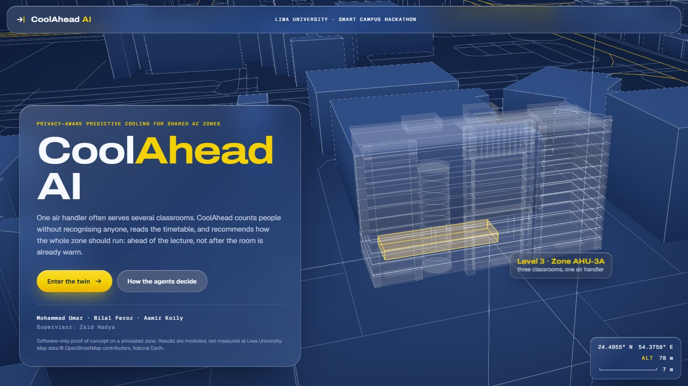
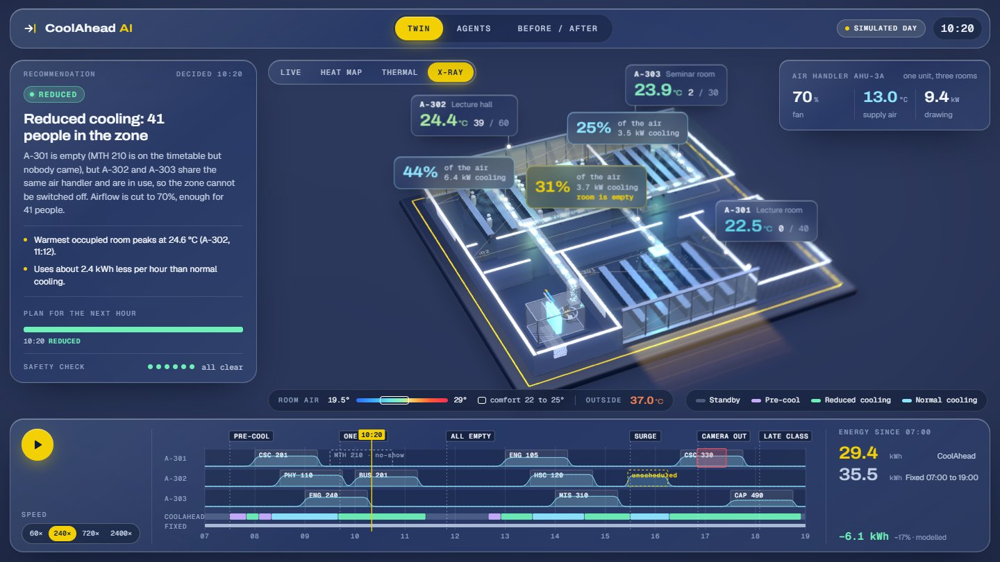
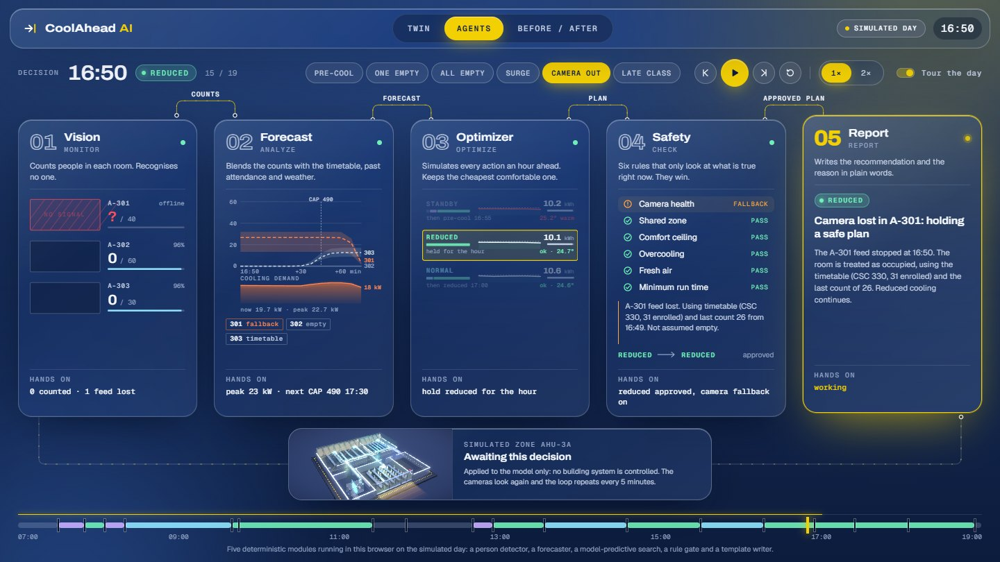
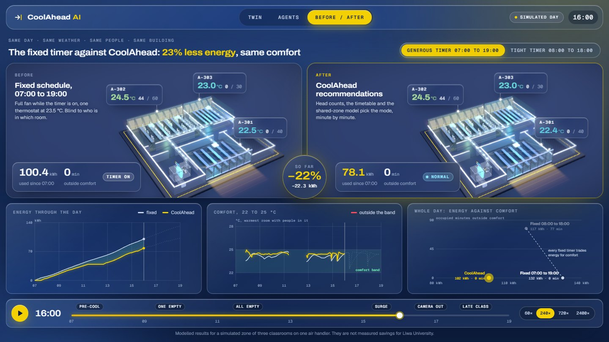

# CoolAhead AI

**Privacy-aware predictive cooling for shared AC zones.**
Liwa University Smart Campus Hackathon.

**Live demo: https://coolahead-ai.vercel.app**



## The problem

In many campus buildings one air handler serves several classrooms. A fixed
timer cannot see that one of those rooms is empty while the others are full, or
that a lecture is about to start in a room that is still warm. So it either
cools rooms nobody is in, or it leaves people warm.

CoolAhead looks at the whole shared zone and recommends how its one air handler
should run, in four steps:

| Step | What happens |
| --- | --- |
| **Monitor** | Count the people in each room. Counts only: nobody is recognised and no image is kept. |
| **Analyze** | Blend the counts with the timetable, past attendance and the weather into a forecast for the next hour. |
| **Optimize** | Run every possible action through a thermal model of the zone and keep the cheapest plan that keeps occupied rooms comfortable. |
| **Report** | Explain the recommendation in plain words for the facilities team. |

A rule-based safety check sits between Optimize and Report. It looks only at
what is true right now (camera health, the shared zone, the comfort ceiling,
overcooling, fresh air, minimum run time) and it overrides the plan when a rule
objects.

## What is in the demo

- **Intro.** From the outline of the UAE down to the Liwa University campus in
  Abu Dhabi and into the zone on level 3.
- **Twin.** A 3D model of the zone: three classrooms on one air handler, driven
  minute by minute by the simulation. Four views: live, people heat map, thermal
  and an x-ray of the ductwork that shows how much of the air each room gets,
  wanted or not.
- **Agents.** The five steps as a pipeline, replayed for the 19 decisions of the
  day where the mode or the reasoning changes.
- **Before / After.** The fixed timer and CoolAhead on the same day, side by
  side, with energy, comfort and the trade-off between the two.





## Results on the simulated day

Same weather, same people and same building for every controller.

| Controller | Energy, 07:00 to 19:00 | Occupied room-minutes outside 22 to 25 °C |
| --- | --- | --- |
| Fixed timer, 07:00 to 19:00 | 132.2 kWh | 0 |
| Fixed timer, 08:00 to 18:00 | 117.2 kWh | 77 |
| **CoolAhead** | **101.8 kWh** | **0** |

CoolAhead uses 23% less energy than the generous timer at the same comfort. It
also uses 13% less than the tighter timer, which saves energy only by leaving
occupied rooms warm for 77 minutes.

> These are **modelled** results for a simulated zone. They are not measured
> savings for Liwa University, and no building system is controlled.



## The test day

The day is built to contain the situations a shared zone has to cope with:

- an upcoming lecture, so the zone is pre-cooled before people arrive
- one room empty because a class did not show up, while the others are in use
- all rooms empty over midday
- a sudden, unscheduled group of 44 people in the lecture hall
- a camera that stops reporting for 35 minutes
- a late class after the others have finished

## How it works

Everything runs in the browser. The engine is plain TypeScript with no
dependencies and simulates the whole day in well under a second.

| Part | File | What it does |
| --- | --- | --- |
| Thermal model | `src/engine/plant.ts` | Two-node (air and mass) model per room, one air handler with a fixed duct split of 31 / 44 / 25%, coil control and energy use |
| Occupancy | `src/engine/occupancy.ts` | Who is really in each room, and what a counting camera would report |
| Forecast | `src/engine/forecast.ts` | Next-hour occupancy per room with its basis: counted, timetable, no-show, unscheduled or camera fallback |
| Optimiser | `src/engine/optimizer.ts` | Receding-horizon search over standby, reduced, normal and pre-cool, re-run every 5 minutes |
| Safety check | `src/engine/safety.ts` | Six rules that can override the plan |
| Report | `src/engine/report.ts` | Writes the recommendation and its reason from the numbers, by rule |

Two things worth being clear about:

- **The "agents" are five deterministic modules, not language models.** The same
  inputs always give the same decision and the same words.
- **The head counts are simulated.** This is a software-only proof of concept:
  the camera step produces counts with detector-like noise and a confidence
  value from the simulated occupancy. No video is processed and no person is
  identified.

## Run it locally

Requires a current Node.js (20.19 or newer).

```bash
npm install
npm run dev        # http://localhost:5173
npm run build      # type-check and build into dist/
```

Print the day as numbers, without the interface:

```bash
npx tsx scripts/engine-check.ts
```

The interface is composed for a 16:9 frame and scales to the window, so it
fills a laptop screen or a projector in full-screen mode (F11).

## Built with

React, TypeScript and Vite, with three.js through React Three Fiber for the 3D
scenes.

## Data and credits

- Country outline and borders: [Natural Earth](https://www.naturalearthdata.com/), public domain.
- Streets and building footprints around the campus: © [OpenStreetMap](https://www.openstreetmap.org/copyright) contributors, ODbL.
- Typefaces: Archivo, Geist and Geist Mono, SIL Open Font License.

The campus building is drawn from its public footprint and is an illustration,
not a survey. The zone, its rooms, the timetable and the people in it are
invented for the demonstration.

## Team

Mohammad Umar · Bilal Feroz · Aamir Koily
Supervisor: Zaid Hadya
