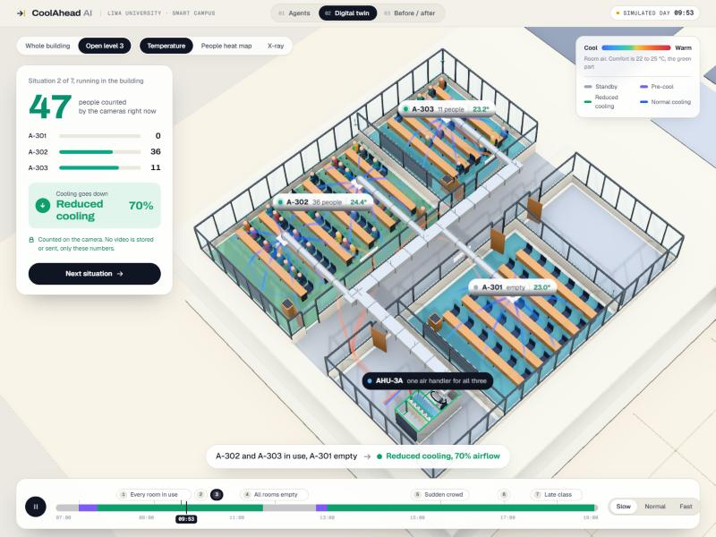

# CoolAhead AI

**Privacy-aware predictive cooling for shared AC zones.**
Liwa University Smart Campus Hackathon.

**Live demo: https://coolahead-ai-two.vercel.app**


## The problem

In many campus buildings one air handler serves several classrooms. A fixed
timer cannot see that one of those rooms is empty while the others are full, or
that a lecture is about to start in a room that is still warm. So it either
cools rooms nobody is in, or it leaves people warm.

CoolAhead looks at the whole shared zone and recommends how its one air handler
should run, following the four steps of the challenge:

| Step | What happens |
| --- | --- |
| **Monitor** | A pretrained YOLO model counts the people in each room's camera picture. Faces are pixelated and only the count is kept. |
| **Analyze** | The counts are combined with the timetable, past attendance and the weather into a forecast for the next hour. |
| **Optimize** | Every way of running the hour is tried on a thermal model of the zone. The cheapest plan that keeps occupied rooms comfortable wins. |
| **Report** | The recommendation and its reason, in plain words, for the facilities team. |

An **orchestrator** runs the loop. Every five minutes, or at once if a count
jumps or a camera drops, it asks the vision, forecast, optimizer and safety
agents in turn and passes each answer to the next. The safety agent holds six
hard rules about what is true right now (camera health, the shared zone, the
comfort ceiling, overcooling, fresh air, minimum run time) and overrules the
optimizer when one of them objects.

## What is in the demo

1. **Intro.** A dive over real satellite imagery of Abu Dhabi, down to the
   Liwa University building, with level 3 picked out.
2. **Agents.** One decision, built up on screen as it happens: the orchestrator
   starts alone, the cameras come on one room at a time with their detection
   boxes and a running tally of people, each agent appears when it is asked,
   and the recommendation arrives last, saying whether cooling goes up or down.
   Seven situations can be stepped through, and any of them replayed.
3. **Digital twin.** A model of the whole building. Opening level 3 shows the
   decision running: a detection box on every student, the tally room by room,
   students walking out when a class ends, cold air leaving the ducts and warm
   air going back. Three views: temperature, a people heat map, and an x-ray
   of the air system.
4. **Before / after.** The fixed timer and CoolAhead on the same day: energy,
   comfort, and where in the day the timer was cooling nobody.

The video never leaves the camera in this design: people are counted on the
device, faces are pixelated, and only the count is passed on.





## Results on the simulated day

Same weather, same people and same building for every controller.

| Controller | Energy, 07:00 to 19:00 | Occupied room-minutes outside 22 to 25 °C |
| --- | --- | --- |
| Fixed timer, 07:00 to 19:00 | 128.3 kWh | 0 |
| Fixed timer, 08:00 to 18:00 | 113.3 kWh | 71 |
| **CoolAhead** | **89.9 kWh** | **0** |

CoolAhead uses 30% less energy than the generous timer at the same comfort. The
tighter timer saves 12%, and only by leaving occupied rooms warm for 71 minutes.

> These are **modelled** results for a simulated zone. They are not measured
> savings for Liwa University, and no building system is controlled. Print them
> yourself with `npx tsx scripts/engine-check.ts`.

## The test day

The day is built to contain the situations a shared zone has to cope with:

- an upcoming lecture, so the zone is pre-cooled before people arrive
- one room empty because a class did not show up, while the others are in use
- all rooms empty over midday
- a sudden, unscheduled crowd in the lecture hall
- a camera that stops reporting for 35 minutes
- a late class after the building timer has switched off

## How it works

The engine is plain TypeScript with no dependencies. It simulates the whole day
in the browser in well under a second.

| Part | File | What it does |
| --- | --- | --- |
| Vision | `scripts/vision/detect.py` | Runs offline: YOLO11 pose model, ByteTrack, head pixelation. Writes a masked clip and one box per person per frame for each room |
| Thermal model | `src/engine/plant.ts` | Two-node (air and mass) model per room, one air handler with a fixed duct split of 31 / 44 / 25%, coil control and energy use |
| Occupancy | `src/engine/occupancy.ts` | Who is in each room through the day, and what its camera reports |
| Forecast | `src/engine/forecast.ts` | Next-hour occupancy per room with its basis: counted, timetable, no-show, unscheduled or camera fallback |
| Optimiser | `src/engine/optimizer.ts` | Receding-horizon search over standby, reduced, normal and pre-cool |
| Safety check | `src/engine/safety.ts` | Six rules that can override the plan |
| Report | `src/engine/report.ts` | Writes the recommendation and its reason from the numbers, by rule |
| Orchestrator | `src/engine/simulate.ts` | The control loop that calls the others in order and decides when to re-plan |

Things worth being clear about:

- **The agents are deterministic modules, not language models.** The same
  inputs always give the same decision and the same words. The one learned
  model in the system is the YOLO person detector.
- **The footage is sample footage.** The clips are stock video, processed once
  with `detect.py`. The number of people the detector finds in a room's clip is
  the head count that room reports during a class, so the picture on screen and
  the number the controller plans on are the same. The day itself (who is in
  which room when) is simulated.
- **Only one zone is simulated.** In the building model, level 3 west is that
  zone. The other 35 replay the same day with shifted timetables to show the
  idea at building scale, and the page says so.

## Run it locally

Requires a current Node.js (20.19 or newer).

```bash
npm install
npm run dev        # http://localhost:5173
npm run build      # type-check and build into dist/
```

Keys on the agents page: space to pause, R to replay, left and right for the
previous and next situation, 1 to 7 to jump to one, Enter to see the decision
run in the building.

The interface is composed for a 16:9 frame and scales to the window, so it
fills a laptop screen or a projector in full-screen mode (F11).

To regenerate the footage, see `scripts/vision/README.md`.

## Built with

React, TypeScript and Vite, with three.js through React Three Fiber for the 3D
scenes. Python, OpenCV and Ultralytics YOLO for the vision step.

## Data and credits

- Classroom footage: see the table in `scripts/vision/README.md` for each clip's source and licence.
- Satellite imagery in the intro: Esri World Imagery, © Esri, Maxar, Earthstar Geographics, loaded live from Esri's tile service.
- Campus footprint: © [OpenStreetMap](https://www.openstreetmap.org/copyright) contributors, ODbL.
- Typefaces: Archivo, Instrument Serif, Geist and Geist Mono, SIL Open Font License.

The campus building is drawn from its public footprint and is an illustration,
not a survey. The zone, its rooms, the timetable and the day are invented for
the demonstration.

## Team

Mohammad Umar · Bilal Feroz · Aamir Koily
Supervisor: Zaid Hadya
